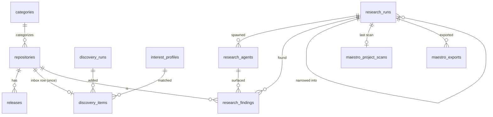

# GitHub Stars Manager: Cloudflare Worker + Postgres retrofit

> The working copy of this design is the Colby Maestro plan in project `github-stars-manager`. This file is the copy kept with the code.
> **Status:** Phase 1 (backend Worker) built and deployed 2026-10-14 at https://github-stars-manager.hacolby.workers.dev. Phases 2 to 4 are planned below.

## The short version

- A new Cloudflare Worker (`worker/`) is the backend: Hono + zod-openapi, Drizzle ORM on Postgres through Hyperdrive, MCP with OAuth 2.1, and a research Workflow.
- Vectors live in Postgres (pgvector, HNSW). Keyword search uses pg_textsearch (BM25). Cloudflare Vectorize is no longer used by the new backend.
- Every model call (chat and embeddings) goes through core-guardian's `GuardianRpc` service binding, so it is routed, metered and budgeted.
- Daily at 13:00 UTC the Worker syncs stars, scans GitHub for new projects that match your interests, and researches Colby Maestro projects whose plans are new or changed.
- On demand, a consultation runs an orchestrator model plus 3 to 5 sub-agents that search GitHub, then ranks, judges, analyzes leverage and writes a report. Findings can become a Colby Maestro plan, epic and tasks.

## Infrastructure

| Piece | Value |
|---|---|
| Worker | `github-stars-manager` (`worker/wrangler.jsonc`) |
| Database | Postgres 17 on LXC 109, database `github_stars`. Extensions: `vector` 0.8, `vectorscale` 0.9, `pg_textsearch` 1.5, `ai` 0.11 |
| Roles | `github_stars_owner` (migrations, from the LAN), `github_stars_app` (runtime, DML only, through Hyperdrive) |
| Hyperdrive | `github-stars-postgres-hyperdrive` = `b4a044ba931849f8a74ca3ad3cf29df5`, via the Access tunnel `postgres-db.hacolby.app`, caching off |
| Secrets (Secret Store bindings) | `WORKER_API_KEY` (passcode, bearer, OAuth unlock), `GH_TOKEN` (Octokit), `CLOUDFLARE_AI_GATEWAY_TOKEN` (bound as requested; the RPC binding does not need it today) |
| Service bindings | `GUARDIAN` -> core-guardian `GuardianRpc`; `MAESTRO` -> colby-maestro (default entrypoint, bearer `WORKER_API_KEY`) |
| KV | `github-stars-oauth` (`0d4726712f6f4c86a665546eff65fdd0`), OAuth grants only |
| Workflow | `github-stars-research` (`ResearchWorkflow`) |
| Cron | `0 13 * * *` |
| Embeddings | `@cf/baai/bge-small-en-v1.5`, 384 dimensions, through `GuardianRpc.workersAi` |
| Local passwords | tokens CLI only: `GITHUB_STARS_PG_OWNER_PASSWORD`, `GITHUB_STARS_PG_APP_PASSWORD` (no Worker reads them, so no Secret Store slot) |

The `ai` (pgai) extension is installed but no provider keys are configured in the database. pgai vectorizers call model providers directly from Postgres, which would bypass core-guardian. Embeddings are computed in the Worker through the guardian and written to pgvector.

## Data

### Schema

The enforced schema is `worker/src/db/schema.ts` (Drizzle), with migrations in `worker/drizzle/` applied by `worker/scripts/migrate.mjs`. `0001_search_indexes.sql` adds the two indexes Drizzle cannot express:

```sql
CREATE INDEX repositories_embedding_hnsw ON repositories USING hnsw (embedding vector_cosine_ops);
CREATE INDEX repositories_search_bm25 ON repositories USING bm25 (search_text) WITH (text_config = 'english');
```

Both were verified with `EXPLAIN`: each query plan is an Index Scan on its index.

### Relationships

| Column | Points to | Cardinality | Enforced by | On delete |
|---|---|---|---|---|
| `repositories.category_id` | `categories.id` | M:1 | foreign key | set null |
| `releases.repo_id` | `repositories.id` | M:1 | foreign key | cascade |
| `discovery_items.repo_id` | `repositories.id` | 1:1 (a repo enters the inbox once, ever) | foreign key + unique index | cascade |
| `discovery_items.run_id` | `discovery_runs.id` | M:1 | foreign key | cascade |
| `discovery_items.profile_id` | `interest_profiles.id` | M:1, null when the profile was derived from stars | foreign key | set null |
| `research_runs.parent_run_id` | `research_runs.id` | M:1 (narrowing and leverage runs) | foreign key | set null |
| `research_agents.run_id` | `research_runs.id` | M:1 | foreign key | cascade |
| `research_findings.run_id` | `research_runs.id` | M:1, unique per (run, repo) | foreign key + unique index | cascade |
| `research_findings.repo_id` | `repositories.id` | M:1 | foreign key | restrict |
| `research_findings.agent_id` | `research_agents.id` | M:1 | foreign key | set null |
| `maestro_project_scans.last_run_id` | `research_runs.id` | 1:1 | foreign key | set null |
| `maestro_exports.run_id` | `research_runs.id` | M:1 | foreign key | cascade |
| `research_runs.maestro_project_key`, `maestro_plan_id`, `maestro_task_id`; `maestro_exports.plan_id`, `epic_task_id`, `task_ids` | Colby Maestro project, plan and task ids | M:1 | derived: Maestro owns these ids; validated when written (export fails on an unknown project) | n/a |

### Diagram



### Tables considered

- **One `repositories` table for stars, discoveries and research findings**, instead of a separate candidates table. The GitHub id is the primary key, so a repository is stored once and research deduplication is a join (`research_findings` joined to earlier runs of the same Maestro project or criterion), not a second copy.
- **Release, category and settings tables** were ported from the SQLite server (`server/src/db/schema.ts`). `ai_configs`, `webdav_configs`, `embedding_configs` and `vector_search_configs` were not ported: model access is core-guardian's job now, and vectors are server-side.
- **`maestro_project_scans`** stores only what Maestro cannot answer: when this app last researched a project and the hash of the plan it used.

## Flows

1. **Star sync** (`POST /api/stars/sync`, daily): list stars (100 pages max), upsert in chunks of 500 rows, set star state, clear stars only from a complete non-empty list, fetch a bounded number of READMEs, embed what changed (`content_hash` skips unchanged text).
2. **Discovery** (`POST /api/discovery/run`, daily): interest profiles (or one derived from your top topics and languages) become at most 24 GitHub searches for repositories created in the last N days above a star floor. Candidates you starred or already reviewed are dropped. The rest are embedded and scored `0.8 x similarity to your star centroid + 0.2 x log stars`; at most 40 scoring 0.6 or more enter the inbox. `POST /api/discovery/read` hides items for good; `POST /api/discovery/items/{id}/star` stars on GitHub.
3. **Consultation** (`POST /api/research`): the Workflow loads context (target repo README and file tree when given), the orchestrator plans 3 to 5 sub-agents with 2 or 3 searches each, sub-agents run as parallel durable steps, candidates are deduplicated, enriched and ranked by similarity, the top 30 are judged for relevance, the top 8 get leverage analysis (idea, service, dependency, fork, none) when there is a target repo or infrastructure, and a report is written. At most 12 model calls per run. The same criterion within 24 hours returns the existing run unless `force`.
4. **Narrow and leverage**: `POST /api/research/{id}/select` marks findings; `POST /api/research/{id}/leverage` starts a leverage run on the selected findings for a new or existing repo and infrastructure. `POST /api/leverage` does the same for repositories you name, outside a research flow.
5. **Maestro auto-research** (daily, `POST /api/maestro/auto-research`): up to 3 Maestro projects with open tasks. A project is researched in full the first time and whenever its newest plan changes; otherwise it is rescanned weekly for repositories no earlier run found. Findings with relevance 0.8 or more become a Maestro plan, an epic and tasks in backlog.
6. **Maestro export** (`POST /api/research/{id}/maestro-export`): one plan with an h2 per finding, one epic, one task per finding attached to its section.

## API, docs and MCP

- `/openapi.json`, `/scalar` and `/swagger` are generated from the route definitions.
- `/mcp` is a code-mode MCP server with two tools, `search` (find an operation) and `execute` (call one `/api` operation through the same app). OAuth 2.1 with dynamic client registration and PKCE; the consent page asks for the passcode (`WORKER_API_KEY`); grants, tokens and client registrations last one year. A bare `Authorization: Bearer <WORKER_API_KEY>` also works for scripts.
- `/health` writes and reads Postgres, checks the GitHub rate limit, core-guardian's routable use cases and Colby Maestro's ping. A failed critical check returns 503.

## Billing

- No new Worker identity per request; one Worker, one Workflow class.
- No `ai` binding. bge-small costs about 9 neurons per call; backfilling all 3,688 stars took 8 calls of 500 texts.
- Postgres on LXC 109 costs nothing on the Cloudflare invoice; D1 and Vectorize are not used.
- Model calls per research run are capped at 12; discovery adds at most 40 items and 24 searches per run.

## Phases

1. **Backend Worker** (done 2026-10-14): everything above.
2. **Point the frontend at the Worker**: replace the Express/SQLite backend adapter and the client-side vector search (`src/services/vectorSearchService.ts`, `backendAdapter.ts`) with calls to the Worker API; remove the browser-held AI keys path in favor of core-guardian.
3. **Frontend retrofit to the ReUI design system**: audit and plan per `AGENTS-frontend.md` (Astro + React + ReUI, Base UI `base-nova`, Data Grid, dark default). New screens: discovery inbox, research runs, leverage results.
4. **Retire legacy pieces**: `cloudflare-worker/` (Vectorize proxy), the Express server and Docker images once the frontend no longer needs them; the unrelated 2025 Worker `gh-stars-sink` (D1, Vectorize, raw `ai` binding) if nothing uses it.
5. **US English pass** (in progress 2026-10-14): Mandarin comments, strings and docs translated to US English by `agy` sub-agents; the zh, zh-TW and ja locale files stay.
